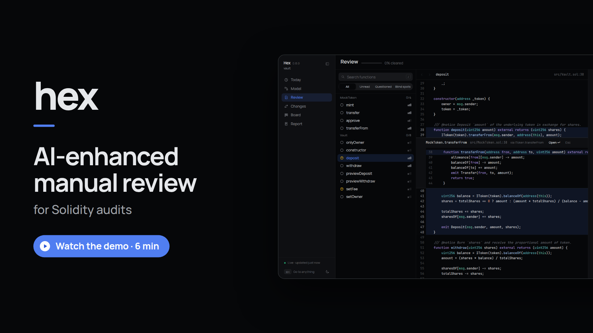
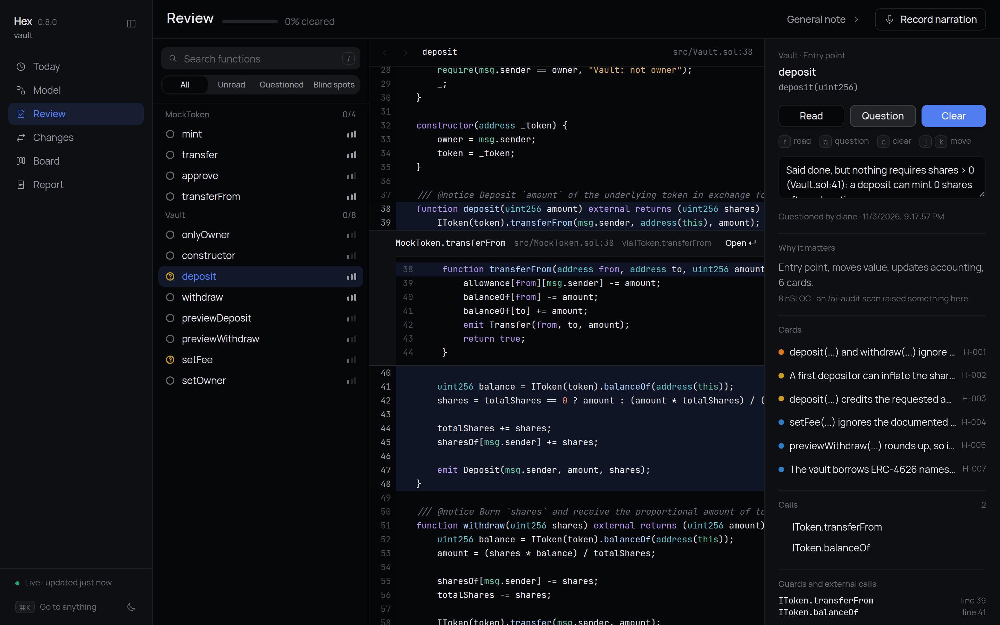

# Hex — AI-enhanced manual review for Solidity audits

You read the code and make the calls. Hex keeps an exact map of the protocol, runs AI where breadth beats depth, and makes the AI prove what it claims.

The first versions of Hex automated the boring parts of an audit. Hex is now a way of auditing in which manual review and AI work as one loop: the AI covers ground fast and checks itself, and you spend your time where judgement matters.

[](https://youtu.be/VIDEO_ID)
<!-- Replace VIDEO_ID with the YouTube video id once the demo is uploaded. -->

## The hybrid loop

| You | Hex |
|---|---|
| Read the code, follow the flows, decide what breaks | Exact facts from the compiler: call graph, every read and write, storage layout, every reference |
| Question the model and accept the invariants that hold | A protocol model built by agents working in silos, then attacked by skeptics; contested claims are marked |
| Write findings, narrate what you see, sign off function by function | Attacker agents over your scope; every finding deduplicated, then reproduced with a PoC or refuted twice |
| Judge the client's fixes | Fix review re-runs every PoC on the fix commit and flags the changes nobody explained |
| Own the report | A report drafted from what you verified |

The two halves meet on the dashboard's **Review** page, a calm workspace next to your Claude Code session:
- **Blind spots:** the riskiest code that nobody, human or AI, has looked at hard yet.
- **Walk flows like in your IDE:** go to definition through interfaces, peek inline, list every caller and every write.
- **Comments in the code**, pull-request style, and **Diane**, a voice pair-auditor who checks what you say against the code.
- **Ask about *this*:** select anything and ask Claude why it is safe; the Hex MCP server tells it what you are looking at.



## What Hex does

**Exact facts from the compiler.** `hex analyze` compiles the project into Hex's own cache (never your `out/`) and reads the solc AST: every call edge resolved by the compiler (`internal`, `super`, `library`, `external`, virtual dispatch, modifiers), every read and write of every state variable, inheritance linearization, entry points, and the compiler's own storage layout. No regexes, no heuristics. When a project does not compile, Hex falls back to a parser and says so.

**A verified protocol model, built by agents.** `/init-audit` runs a team of agents in waves:
- Independent readers each model one cluster of contracts, and a docs reader extracts what the documentation promises without ever seeing the code.
- A synthesizer merges the drafts into one model: actors, assets, privileges and their worst cases, trust assumptions, dependencies, state machines, accounting equations, risky flows, and proposed invariants.
- Skeptics then check every claim against the code without seeing the synthesizer's reasoning. Claims end up `verified` or `contested`, and contested claims are often where the bugs are.

**Diagrams that explain.** Five views drawn from the verified model, rendered in Excalidraw, each with a one-sentence takeaway:
- **custody**: where the money sits and who can move it
- **privilege**: who can do what, and the worst case
- **accounting**: the conservation law and every function that moves each term
- **state machine**: lifecycles and their guards
- **sequence**: the riskiest cross-contract flows

You can edit them in the dashboard and put them in the report.

**Findings with proof.** `/ai-audit` runs 12 attacker agents (a fork of pashov's solidity-auditor). `/prevalidate` reproduces each new machine finding with a PoC or refutes it with two independent agents, and conclusive cases move on their own. `/validate-finding` writes a PoC by default. One dedup engine serves every source. Triage rules (trusted roles, out-of-scope tokens, known issues) feed back into every AI run so the same false positives stop coming back.

**A review workspace next to the CLI.** The dashboard tracks review per function (unread → read → questioned → cleared), ranks blind spots by risk, lets you walk flows and comment in the code, and shows the board, the model and the report. Select something in the dashboard and ask Claude about "this": the Hex MCP server tells the CLI session what you are looking at.

Everything stays local: no server, no database, no accounts.

## Prerequisites

- **Claude Code**
- **Node.js** (v18+) and npm
- **Foundry** (`forge`), or Hardhat if that is what the project uses
- Optional: **Medusa** / **Echidna** for `/fuzz`; `gh` (GitHub CLI) for `/sync-issues` and `/fix-review`; a local Whisper engine (`pip install faster-whisper`) for Diane; the AuditAgent CLI for `/ingest-aa-report`

`hex doctor` checks all of it.

## Quick Start

```bash
git clone https://github.com/client/protocol.git && cd protocol
npm install -g hex-audit
hex claude      # installs the skills and registers the Hex MCP server in .mcp.json
claude          # approve the "hex" MCP server once when asked
```

Inside Claude Code:

```
/init-audit
```

It asks for the scope, commit, chain, docs and (optionally) the GitHub repo, then:
1. Runs the dependency-safety gate before anything compiles.
2. Builds the exact facts.
3. Runs the agent waves.
4. Builds the diagrams.
5. Files conformance deviations as Potential cards.
6. Opens the dashboard at `http://localhost:3000`.

Accept the invariants that hold (on the Model page or with `hex invariant accept`), then start reading. The **Today** page tells you where.

> Always call the CLI as `hex …` or `npx --no-install hex …`. An unrelated npm package is named `hex`; a bare `npx hex` on a machine without hex-audit would download and run it.

---

## The Audit Workflow

### Phase 1: Pre-review (`/init-audit`)

**Waves and silos.** Agents work in silos where independence matters and share context where integration matters. They never message each other; they communicate through files under `.hex/model/` and answer exact questions with `hex facts query`.

| Wave | Who | Silo? | Output |
|---|---|---|---|
| 0 | You + orchestrator: inputs, dependency-safety gate, `hex init`, `hex analyze` | — | `facts.json`, `stats.json`, `diff.json` |
| 1 | Contract readers (one per cluster), docs extractor (docs only), standards checker, prior-audit importer | **siloed** | claim drafts |
| 2 | Synthesizer | shared | `model/protocol.json`, `model/invariants.json`, `overview.md` |
| 3 | Skeptics (per model section), conformance checker, regression checker | **siloed** | verified / contested claims, conformance cards |
| 4 | Diagram composers (per view) | shared | `model/diagrams/*.excalidraw` |

#### Differential audits

Pick **Differential** when `/init-audit` asks. Give the base commit (what the previous audit covered), the head commit, and optionally the previous audit (its `.hex/` folder or its report).
- **What changed:** `hex diff` compiles both commits and reports every changed function, modifier, variable, event, error, struct and base list.
- **Storage layout:** the compiler storage-layout diff, slot by slot. An insertion that shifts every later slot is called out explicitly.
- **Impact:** every function the change reaches, through calls, modifiers, state coupling, virtual dispatch and inheritance.
- **Focus:** every wave then focuses on the change.
- **Prior findings:** imported, and the ones the change touched are regression-checked. Only regressions become cards.
- **Dashboard and report:** a Changes page appears, and `/generate-report` writes a differential review.

### Phase 2: Review

**Review map.** Read the code with the dashboard's **Review** page open:
- Every in-scope function has a state (unread, read, questioned, cleared) and a risk score built from facts and the model: moves value, updates accounting, external calls, privileged, changed in a diff, and so on.
- **Blind spots** are the riskiest functions nobody, human or AI, has looked at hard.
- Mark functions with the keyboard (`r`/`q`/`c`) or the inspector.
- **Walk flows like in your IDE.** Ctrl/⌘-click (or F12) any call, variable, type or event to go to its definition; calls through an interface land where they run (`IToken.transferFrom` → `MockToken.transferFrom`). Alt-click (⌥F12) peeks the code inline under the call. On a function's name, or with ⇧F12, a band lists every call site (or every read and write of a state variable). Back and Forward retrace the path, and the code header shows the trail. Upstream and downstream come from the compiler (`.hex/xref.json`, written by `hex facts`); `hex facts query call-sites|implementations` gives the same answers to Claude.
- **Comment on code** like a pull request: hover a line and click `+`, or select lines and click *Comment*. Comments are stored in `.hex/notes/comments.json` and follow their code when lines move. *Write to source* puts a comment into the file as `// @audit` lines (and *Remove from file* takes it out again); Hex rebuilds the facts afterwards because the line numbers shift. Diane and Claude read them (`hex note comments`, MCP `hex_code_comments`).

**Diane, the voice pair-auditor.** Narrate while you read: record on the Review page, then run `/diane`. Diane:
- turns the narration into a structured note for the contract;
- checks your claims against the code, then corrects mistakes and flags what you missed;
- **ticks the functions you say you are done with**. Only what you say counts; she never ticks on inference, and a function where she found a problem goes to *questioned* instead.

Transcription is local (Whisper).

**Record findings and run the AI.**
- **Manual findings:** `/write-finding`.
- **AI audit:** `/ai-audit` runs 12 attacker agents over the scope, or over the changed and impacted code in a differential audit. Every agent is briefed with your accepted invariants and triage rules. Findings land on the board, deduped against everything there, and leads go to the contract notes. Then `/prevalidate` runs on the new cards.
- **AuditAgent:** `/ingest-aa-report <scan-id>` ingests a Nethermind AuditAgent scan the same way.
- **Fuzzing:** `/fuzz` (a fork of pashov's fizz) turns accepted invariants into Echidna/Medusa/Foundry suites. Results sync back to each invariant; a violation becomes a card whose repro test is its PoC.

### Phase 3: Validate, sync

- **`/prevalidate`.** Validates every new machine-generated card in parallel. It moves a card on its own only in two conclusive cases:
  - **reproduced:** the PoC passes, asserts the impact, and the finding passes the reality gate → Verified;
  - **refuted:** two independent agents cite the blocking code → Rejected.

  Everything else waits for you with a verdict and memo. Every auto-move is marked and can be reverted with one click.
- **`/validate-finding`** and **`/validate-all-findings`**: correctness, then a reality gate (true *and* a security issue?). A PoC is the default and is recorded on the card. Rejecting a finding as by-design or out of scope proposes a triage rule.
- **`/sync-issues`.** Two-way sync with GitHub Issues, and GitHub is the source of truth:
  - Identity is the issue number.
  - Synced cards are read-only in Hex: edit on GitHub and pull.
  - Verified cards are pushed as the five-field body (File(s), Description, Recommendation(s), Status, Update from the client).

### Phase 4: Fix review and report

- **`/fix-review`**. After the client fixes the issues, it:
  1. Maps fix commits to cards.
  2. Re-runs every PoC at the fix commit in a throwaway worktree. A PoC that reproduced the bug and now fails is the strongest proof of a fix.
  3. Sends the rest to judgement agents.
  4. Flags code the fixes changed that no finding explains, reviews each change, and records the verdict (a new card when it finds a problem).
  5. After **one confirmation**, updates only the Status and Update-from-the-client fields of each GitHub issue.
- **`/generate-report`**. Emits the seven LaTeX report sections, as `.txt` + `.tex`, from the synced issues. The System Overview uses the verified model and embeds the diagrams you marked "Use in report".

---

## Claude Code Skills

| Skill | What it does |
|---|---|
| `init-audit` | Safety gate, exact facts, multi-agent protocol model + invariants + conformance + diagrams; full or differential |
| `ai-audit` | 12 parallel attacker agents (pashov solidity-auditor v4.1 fork); findings → board (deduped, pre-validated), leads → notes |
| `prevalidate` | Parallel PoC-or-refute validation of new machine cards; conclusive cases auto-move |
| `fuzz`, `fuzz-sync`, `fuzz-convert` | Fuzz accepted invariants (pashov fizz fork); violations become cards |
| `write-finding` | Record a manual finding as a Potential card |
| `validate-finding`, `validate-all-findings` | Validate cards; PoC by default; propose triage rules |
| `generate-poc` | Write and run a PoC (used by the validators) |
| `diane` | Narration → structured notes, pair-audit corrections, review ticks |
| `ingest-aa-report` | Ingest a Nethermind AuditAgent scan |
| `sync-issues` | Two-way GitHub Issues sync (GitHub canonical) |
| `fix-review` | Check fixes (PoCs re-run at the fix commit) and update GitHub after confirmation |
| `generate-report` | LaTeX report sections + figures |

Skills live in `.claude/skills/<name>/` and are editable per project. `hex claude` / `hex update-skills` only remove skills Hex installed itself (tracked in `.claude/skills/.hex-skills.json`).

## The Hex MCP Server

`hex claude` registers `hex mcp` in the project's `.mcp.json` (Claude Code asks you to approve it once). It gives the CLI session typed tools:
- **`hex_focus`**: what you have selected in the dashboard.
- **`hex_facts_query`**: exact callers, callees, readers, writers, layout, linearization and reach.
- **Model:** `hex_model_get`, `hex_invariant_*`.
- **Board:** `hex_board_list`, `hex_issue_*` (including validation, dedup and mark-duplicate).
- **Review map:** `hex_review_*`.
- **Notes and rules:** `hex_note_*`, `hex_rules_*`.

So "why is this safe?" in the terminal knows what "this" is.

## The Dashboard

Six destinations, one question each:

| Page | What it answers |
|---|---|
| **Today** | What should I do next? Progress, the top blind spots, cards that need triage, recent changes |
| **Model** | How does the system work? Excalidraw diagrams with takeaways (editable, exportable to the report), actors, assets, privileges, trust, dependencies, accounting, invariants, spec conformance; verified vs contested claims |
| **Review** | What have I read? Contracts → functions with review state and risk; full code viewer; inspector with facts, notes, cards and Diane's recorder |
| **Changes** | (differential audits, or after `/fix-review`) What changed, what it reaches, storage layout; fix review results |
| **Board** | Potential / Verified / Synced / Rejected / Duplicate, with validation verdicts, PoCs and auto-move reverts |
| **Report** | The LaTeX sections and figures, ready to paste into Overleaf |

It refreshes live as the CLI writes to `.hex/`. `⌘K` searches pages, contracts, functions, cards and invariants.

## Output Directory (`.hex/`)

```
.hex/
├── config.json              # scope, mode, commits, settings
├── facts.json               # exact compiler facts (or parser fallback, flagged)
├── stats.json               # nSLOC, ERCs, coverage
├── model/
│   ├── protocol.json        # verified protocol model
│   ├── invariants.json      # invariants + test results
│   ├── drafts/, verdicts/   # agent working files
│   └── diagrams/            # <name>.spec.json, <name>.excalidraw, index.json
├── overview.md, diff-overview.md
├── spec-conformance.json/.md
├── diff.json, diff/changes.patch           # differential mode
├── previous-audit/{findings,review}.json   # differential mode with a prior audit
├── findings.json, tracking.json, comparison.json
├── validations/<id>_memo.md
├── progress.json            # per-function review state
├── triage-rules.json
├── notes/                   # Diane: contract notes, sessions, audio
├── ai-audit/runs/<stamp>/   # /ai-audit run files and reports
├── ai-results/{ai-audit,auditagent}/findings.json
├── fuzz/                    # /fuzz PROPERTIES.md, run data, corpora
├── fix-review/<sha>.json
├── focus.json               # current dashboard selection (read by hex_focus)
├── report/                  # LaTeX sections + figures/
└── .cache/                  # build-info, compiler output, worktrees
```

## CLI Reference

| Command | What it does |
|---|---|
| `hex doctor` | Preflight check |
| `hex claude` | Install skills into `.claude/skills/`, register the MCP server |
| `hex init [--mode diff --base <c>] …` | Initialise the audit config |
| `hex analyze` | `facts` + `stats` (+ `diff` in differential mode) |
| `hex facts` / `hex facts query <q> [ref]` | Build exact facts and the navigation index (`.hex/xref.json`) / query them: `callers`, `call-sites`, `callees`, `implementations`, `readers`, `writers`, `layout`, `linearization`, `entry-points`, `reach`, `function` |
| `hex stats` | nSLOC, ERCs, coverage |
| `hex diff [--focus <file>] [--scan-files]` | Differential analysis |
| `hex model show\|validate\|apply-verdicts` | The protocol model |
| `hex invariant list\|accept\|reject\|set-test\|link-issue\|export\|sync-fuzz` | Invariants |
| `hex diagram build\|list` | Build Excalidraw scenes from specs |
| `hex review mark\|status\|blind-spots` | The per-function review map |
| `hex issue new\|move\|patch\|show\|validation\|revert-auto\|dedup\|mark-duplicate\|exclude\|sync-set` | Board cards |
| `hex rules list\|add\|remove\|export` | Triage rules |
| `hex note …` | Notes (Diane), including `note lead` |
| `hex fix-review [run]\|propose\|reviewed\|apply` | Fix review |
| `hex mcp` | The MCP server (started by Claude Code) |
| `hex dashboard [--port <n>] [--no-open]` | The review workspace |
| `hex ai-status [--watch]` | AuditAgent scan status |
| `hex update`, `hex update-skills` | Update the package / re-sync skills |
